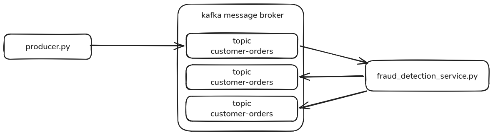

# real-time sales pipeline
made by a human

## Description
A real-time sales pipeline using Docker containers and Apache Kafka to simulate, ingest, transform, and store streaming order events.

This is an introductory project for beginners to learn Apache Kafka.

## What is Apache Kafka and why use it ?
Let's say you have a web app, maybe an e-commerce website. Black Friday comes by and suddenly you have a massive amount of users signing up, making orders, browsing ..etc. your website is slow ! and can't handle that much traffic. That's when you decide to implement an Apache Kafka pipeline.

Kafka is basically a super mail carrier that decouples message delivery between your apps so none of them crash if one gets too slow or busy.

I honestly like it for 2 reasons:
1. It handles performance. obviously. with a distributed architecture.
2. It simplifies inter-service calls when your project gets big. So when let's say you need to process an order, you don't have to manually call each service that comes after placing an order like sending an email, updating the inventory, processing the transaction.. that is too much work. instead,  you just send an "event" to a kafka message broker and every concerned service will  do their thing automatically when they see the new order-placed event.

## Main protagonists

**Kafka message broker** the running Kafka container which contains every topic and handles the traffic.
**Kafka topic** a folder or group within the message broker to organise the messages. each domain has it own topic. for example email-notifications is a topic.
**producer** the entity that will send a message to a kafka topic.
**consumer** the entity that will trigger an action when it receives a new message on a kafka topic.

## real-time sales pipeline example
This project is a demonstration of how a Kafka pipeline works, in our example we will simulate a sales processing pipeline.
A python script will generate sales and python script will process those sales and flag them as fraudulent if the amount > $1000. The goal is to use a message broker.

**producerpy** generates an order every 2 seconds, will send the order to a Kafka topic consumer-orders.
**fraud_detection_service.py** a service subscribed to the consumer-orders topic. Will send a message to processed-orders topic if the order is valid, else will send a message to fraud-alerts topic if the order's amount is over $1000.
**kafka message broker** Our message broker runs inside a container and contains the three topics: consumer-orders, processed-orders, fraud-alerts and they are automatically created by our container as a service interacts with them.

**Note:** All of the services run inside a docker container.

## Scenario workflow
1. producerpy will generate an order.
2. producerpy will send the order as a message to our Kafka container, specifically to the topic consumer-orders. connected via a docker container network.
3. fraud_detection_service.py is subscribed to the topic consumer-orders. Will read the new message of the newly placed order.
4. If the order.amount is over $1000, it will send a message to the fraud-alerts topic. which will trigger other services subscribed to this topic.
5. Else, send a message to the processed-orders topic. 
6. Services connected to the processed-orders topic will update database to flag the order as processed.

## How to setup
everything is containerised. just run `docker compose up --build -d` then  `docker compose logs -f fraud_detection_service` to watch the live fraud_detection_service script logs.
